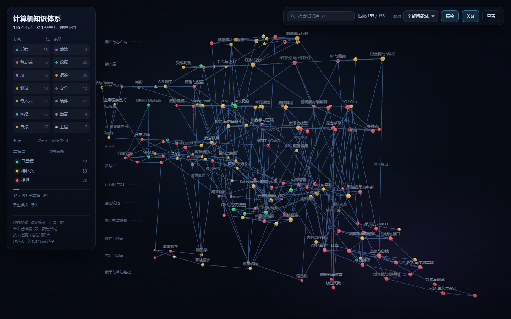
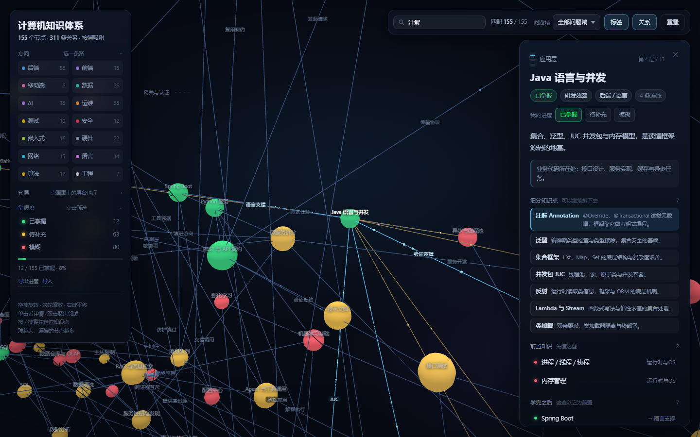
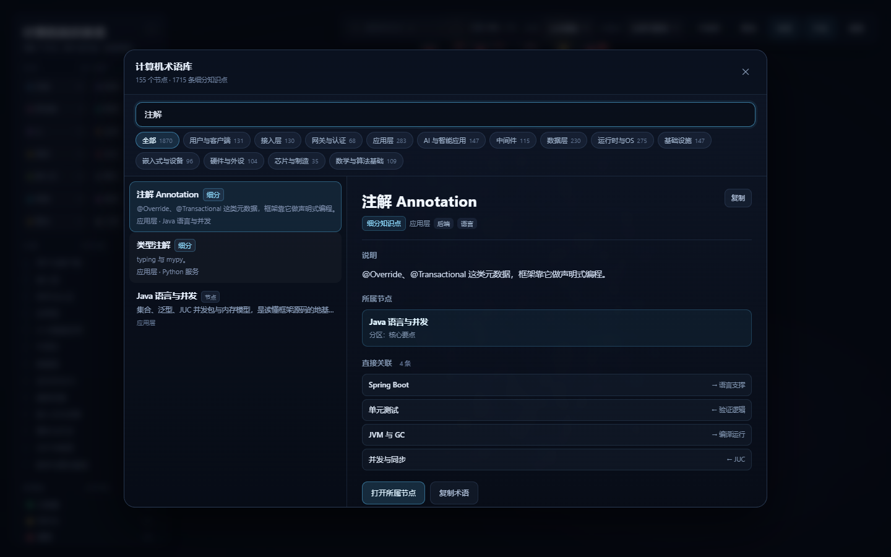
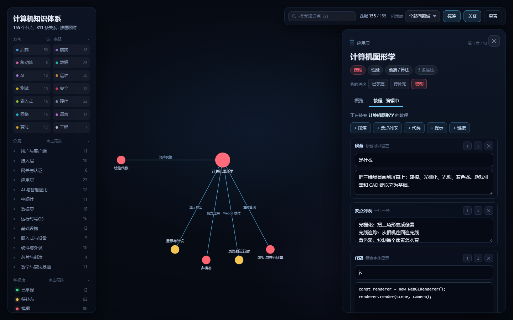
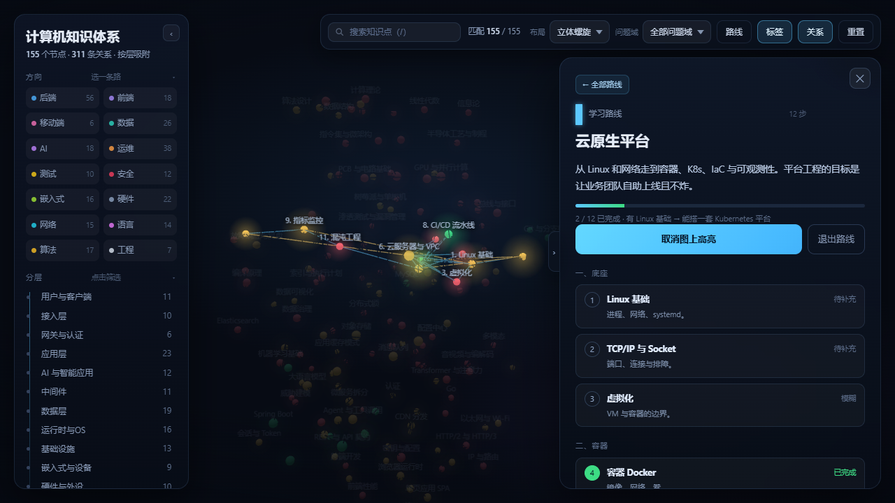
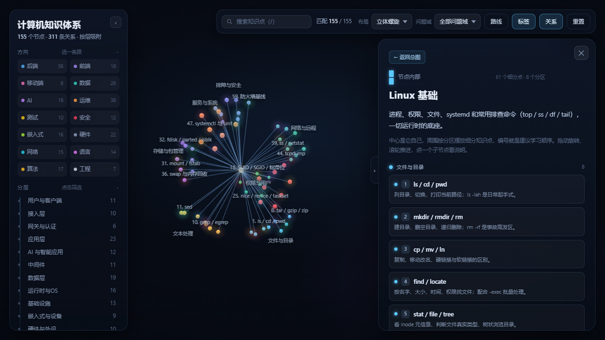

# 计算机知识体系 · 3D 交互图谱

**155 个知识点、1700+ 条细分知识点、311 条关系、13 条学习路线，从浏览器页面一路排到芯片、晶圆和数学基础。**

不是目录树，也不是课程表，而是一张可以转起来的知识地图：每个点都能告诉你它在系统里的哪一层、属于哪些方向、学之前要先懂什么、学完之后能接上什么、和谁是什么关系。

**在线体验（GitHub Pages）：<https://renbohao888.github.io/computer-knowledge-graph/>**（页面内写教程在 Pages 上只保存在本机浏览器；完整服务器版用下面的 Docker 部署）



## 覆盖范围

**13 层，从上到下**：

用户与客户端 → 接入层 → 网关与认证 → 应用层 → AI 与智能应用 → 中间件 → 数据层 → 运行时与 OS → 基础设施 → 嵌入式与设备 → 硬件与外设 → 芯片与制造 → 数学与算法基础

**14 条方向，横切上面这些层**：

后端 / 前端 / 移动端 / 数据 / AI / 运维 / 测试 / 安全 / 嵌入式 / 硬件 / 网络 / 语言 / 算法 / 工程

内容上覆盖到：编译原理、操作系统、网络协议、分布式与共识、数据仓库与数据清洗、图形学与音视频、机器学习与大模型、RAG 与 Agent、单片机与 RTOS、树莓派与边缘计算、CPU/GPU/NPU、指令集与半导体制程、数据结构与计算理论。每个知识点都能点进去看自己的内部 3D：1700+ 条细分知识点按分区摆放、按学习顺序编号，每个分区有自己的名字与颜色。

## 为什么不是一棵目录树

一张图里叠了四种信息：

| 维度 | 怎么表达 | 回答的问题 |
|---|---|---|
| **分层**（13 层） | 节点的垂直位置，左栏的分层列表 | 它在系统的哪一层？ |
| **方向**（14 条） | 方向模式下同一种颜色 | 我走这条路要掌握哪些？ |
| **学习路径** | 金色连线 + 流动粒子 | 先学什么，再学什么？ |
| **关系短语** | 写在连线中间的文字 | 这两个东西到底是什么关系？ |

一个节点可以同时属于多条方向。比如「Redis」同时是后端和数据，「树莓派」同时是嵌入式和硬件。

## 快速开始

### Docker（推荐的部署方式）

```bash
docker compose up --build -d
```

打开 <http://localhost:8787>。整个应用只有一个 Python 容器（只用标准库，没有第三方依赖），
页面内写的教程保存在宿主机的 `data/content.json`，重建镜像不会丢。

不用 compose 也行：

```bash
docker build -t computer-knowledge-graph .
docker run -d -p 8787:80 -v "$PWD/data:/data" --name ckg computer-knowledge-graph
```

### 本地预览（零依赖）

```bash
node scripts/serve.mjs          # Node 20+，带内容 API
# 或者
python3 server/api.py           # Python 3.8+，同时托管页面和 API
```

打开 <http://127.0.0.1:8791>（Python 版是 <http://127.0.0.1:8000>）。也可以直接双击 `index.html`（首次需要联网从 CDN 取 3d-force-graph），这种打开方式下教程编辑只能存在本机浏览器。

### 开发模式（改完刷新即可，不用重建镜像）

```bash
docker compose -f docker-compose.dev.yml up -d
```

打开 <http://localhost:8790>。`src/` 和 `index.html` 直接挂进容器，改完刷新浏览器就生效。

## 搜索能细到什么程度

搜索框在右上角，按 `/` 或 `Ctrl+K` 聚焦。它不只知道节点名，还知道别名、英文名和**细分知识点**：

| 你搜 | 得到 |
|---|---|
| `js` / `ts` | JavaScript / TypeScript 节点（缩写只返回节点，不会被 jstack、JSON 这类词刷屏） |
| `注解` | Java › 注解 Annotation（细分结果，点一下直接进入 Java 的内部 3D 并定位） |
| `网络安全` | 学习路线 › 网络安全（点一下打开整条链路） |
| `泛型` | JavaScript / TypeScript › 泛型、Java › 泛型与擦除（细分/分区结果） |
| `ci cd` | CI/CD 流水线 › 持续集成 CI（面板里高亮这一条） |
| `注解` / `java 注解` | Java 语言与并发 › 注解 Annotation |
| `大模型` | 大语言模型 |
| `数据清洗` | 数据清洗（数据层的独立节点） |
| `树莓派` | 树莓派与单板机（嵌入式和硬件的交叉点） |
| `主从延迟` | MySQL（作为细分知识点命中） |
| `运维` | 所有属于运维方向的节点 |

命中细分知识点时，详情面板会滚到那一条并高亮它，所以"这个点属于哪个模块"一眼就能看到。



### 术语库

右上角「术语库」把 155 个节点和 1715 条细分知识点变成可检索词条：按层筛选，搜术语、别名或描述，查看说明、所属节点与直接关联，点一下就能跳回 3D 图。适合回答"这个词是什么意思、它属于哪个模块"。



## 交互

| 操作 | 效果 |
|---|---|
| 右上「布局」 | 立体螺旋 / 自由星云 / 分层平面 三种 3D 布局互切，自动重新取景 |
| 右上「术语库」 | 检索 155 个节点与 1715 条细分知识点，看说明、所属节点与关联，可跳回 3D 图 |
| 右上「路线」 | 6 条学习链路，可在图上高亮并显示步骤序号 |
| 左栏「‹」/ 面板左缘「›」 | 收起左栏或详情面板，边缘留把手，点一下展开；面板滚到底时关闭按钮也始终固定在右上角 |
| 左键拖拽 | 旋转（穿行时控制方向） |
| 滚轮 | 先把镜头推近；推到头后继续滚 = 沿正前方直线穿行（第一人称，不自动拐弯），往回滚原路退出；选择方向或学习路线后同样可用 |
| 右键拖拽 | 平移 |
| 右键单击 | 切换左键为「平移 / 旋转」，底部有提示 |
| 单击节点 | 主画面摊平成 **2D 关系图**：当前节点居中，前置在左、后续在右、关联在下；在 2D 里继续放大某个节点会直接进入它的内部 3D，缩小到底则回到 3D 全景 |
| 关闭详情 / Esc / 双击空白 / 重置 | 回到 3D 全景，2D 关系图会先向内缩小淡出再切回 |
| 双击节点 | 聚焦直接邻域，其余淡出；再双击或 Esc 退出 |
| 节点内部 3D | 拖动旋转以集合中心为轴固定不漂移；一直缩小会自动退回该节点的视图 |
| 悬停节点 / 连线 | 浮动提示；连线会显示两端和关系 |
| 左上「方向」 | 只亮这一串，镜头收到这串节点的包围盒上 |
| 左上「分层」 | 按层筛选（13 层按顺序列出） |
| 左上「掌握度」 | 按状态筛选，不相关节点变暗但保留位置 |
| 右上搜索 | 节点 / 细分点 / 分区 / 学习路线一起联想；点细分结果直接进入该节点的内部 3D |
| 右上「标签」「关系」 | 分别开关节点名与连线关系文字 |
| 右上「重置」 | 清空筛选与选中，重新取景 |
| 详情面板「我的进度」 | 标记 已掌握 / 待补充 / 模糊，存在浏览器本地，可导出 |

方向模式下颜色代表方向、亮度代表掌握度：越亮越需要补。

### 详情页与教程

每个知识点都是一页，地址形如 `#/redis`，可以直接收藏、分享，刷新后自动回到这一页。

详情页分两个标签：

- **概览**：一句话说明、细分知识点、前置 / 学完之后 / 其他关联
- **教程**：是什么、为什么重要、核心概念、代码示例、常见坑、官方文档链接

点开节点时，**主画面本身**会从 3D 摊平成一张 2D 关系图（王者荣耀人物关系图那种）：当前节点居中放大，前置在左半圈、后续在右半圈、其他关联在下方，连线上标注关系；点关系图里的任何节点可以继续跳转。

右上角的 ✕、`Esc`、点击空白处都能关闭详情页。

教程正文在 `src/data/articles.js`，按节点 id 组织，目前覆盖 24 个高频节点；没写教程的节点会显示"待补"，不影响其它功能。

### 直接写教程（不用改代码）

打开任意节点的「教程」标签：

- 没有教程的：点 **✍ 写这篇教程**
- 有教程的：点 **✏️ 编辑这篇教程**

编辑器按块组织内容：段落（可带小标题）、要点列表、代码（可选语言）、提示、链接。
每块都能上移、下移、删除；空块保存时自动丢弃。

保存后写进 `data/content.json`，**其他人刷新页面就能看到**，不需要重新构建镜像，
也不需要会 Git。服务器不可用时会退回"只存本机浏览器"，并提供 JSON 下载。

- 改坏了：编辑页里的「恢复原版」可以删掉你的覆盖，回到仓库里的版本
- 人工兜底：每次保存前，旧版本会留一份 `data/content.backup.json`
- 内容格式和 `src/data/articles.js` 完全一致，随时可以搬进代码库



> 内容 API 没有鉴权，适合本机、教室局域网或内网部署。如果要放公网，请在前面加一层登录 / Basic Auth，或者把编辑接口关掉。

### 学习路线

右上角「路线」给出 13 条完整学习链路：网络安全、后端开发、前端开发、数据分析与 AI、嵌入式开发、运维 / SRE、算法与数据结构、数据库 / DBA、测试开发、移动端开发、图形与游戏、大模型应用、云原生平台，共 161 步。

每条路线按阶段排列，比如学网络安全会从 Linux、Shell、搭虚拟机实验环境开始，再到网络、HTTP、Web 攻防、密码学、身份认证、WAF 与应急响应。步骤分两类：

- **有节点的步骤**：点一下直接跳到图里那个知识点，看它和谁相连
- **纯动手任务**（装虚拟机、做实验）：可以自己打勾，进度存在浏览器里

点「在图中高亮这条链路」，3D 图只点亮这条路线上的节点，其余压暗，节点名前带上步骤序号（1. Linux 基础、2. Shell 与脚本 …），一眼看出先学什么、在哪一层。



路线的阶段划分参考了 [roadmap.sh / developer-roadmap](https://github.com/kamranahmedse/developer-roadmap) 等公开路线图的常见路径，具体到每个知识点的细分内容按本项目的体系重写。

### 节点内部 3D

每个知识点都有自己的内部结构。打开一个节点，点「🧬 进入内部 3D」：

- 中心是它自己，周围按分区摆放它的细分知识点；比如 Linux 基础有 9 个分区、65 个细分点：文件与目录、文本处理、权限与用户、进程与资源、存储与包管理、网络与远程、服务与系统、排障与安全、核心要点
- 每个分区一种颜色、分区末端写着区块名，子节点按学习顺序编号；可以悬停、点击看说明
- 旋转、滚轮推进和总图完全一致；「← 返回总图」或 Esc 回到 155 个节点的全景



节点的细分内容参考了各方向的经典教材目录与开源课程（如 [The Linux Command Line](https://linuxcommand.org/)、[MIT Missing Semester](https://missing.csail.mit.edu/)），但描述与组织按本项目重写。

### 我的进度

每个节点在详情面板里都能标"我的进度"，再点一次取消。标记只存在你自己的浏览器（localStorage），不会改仓库里的数据，也不会影响别人。

- 左侧「掌握度」和进度条会跟着你的标记变化
- 换了电脑或想备份：点「导出进度」得到 `knowledge-progress.json`，在新设备上「导入」即可
- 数据里的 `status` 是作者的初始标注；你标记之后会显示"作者标注 xxx"，随时可取消

## 数据怎么维护

数据就在 Git 里，是可 diff 的 JS 字面量，不是数据库——这样任何人都能用 PR 贡献。按学科拆成了几个文件，谁熟悉哪块就改哪个：

```
src/
├── config.js                层、方向、颜色、共享状态
├── data/
│   ├── nodes.js             软件系统主干（82 个）
│   ├── nodes-client.js      前端 / 移动端 / iOS
│   ├── nodes-engineering.js 架构、测试、安全、图形与音视频
│   ├── nodes-data-ai.js     AI、数据、数学与算法
│   ├── nodes-systems.js     网络、运行时、基础设施、嵌入式、硬件
│   ├── links.js             主干关系
│   ├── links-more.js        第二批关系
│   ├── articles.js          教程正文（一篇一个数组）
│   ├── paths.js             学习路线（前 6 条）
│   ├── paths-more.js        学习路线（后 7 条，共 13 条 161 步）
│   ├── details-os-net.js    节点内部拆解：OS / 网络 / 接入
│   ├── details-backend.js   节点内部拆解：数据库 / 中间件 / 后端
│   ├── details-web.js       节点内部拆解：Web 安全 / 前端
│   ├── details-data-ai.js   节点内部拆解：数据 / AI / 数学
│   ├── details-infra-embedded.js  节点内部拆解：基础设施 / 嵌入式 / 硬件
│   ├── details-lang-arch.js 节点内部拆解：语言 / 架构 / 测试
│   └── details-extra.js     节点内部拆解：剩余节点补齐
├── core/
│   ├── util.js              转义、颜色混合
│   ├── store.js             索引、匹配、连线流向
│   ├── graph.js             3D 初始化、样式、相机
│   ├── progress.js          我的进度（localStorage + 导入导出）
│   ├── content.js           教程内容读写（服务器优先，失败落本机）
│   ├── sub-model.js         节点内部 3D（子知识点分区）
│   └── actions.js           选中 / 聚焦 / 方向模式 / 替换数据
├── ui/
│   ├── panel.js             详情面板、方向概览
│   ├── editor.js            页面内教程编辑器（块式）
│   ├── paths.js             学习路线面板
│   ├── search.js            搜索（别名 + 子知识点 + 多词）
│   ├── labels.js            节点名、连线关系、光晕
│   ├── rail.js              左栏、工具条、筛选同步
│   └── tooltip.js           悬浮提示
├── server/
│   └── api.py               零依赖服务：静态页面 + 内容 API
└── main.js                  启动与渲染循环
```

运行时数据（不进镜像，由 `data/` 卷保存）：

```
data/
├── content.json             页面上写的教程（服务器保存）
└── content.backup.json      每次保存前自动留的上一版
```

加一个知识点、拆一个知识点、补一条关系，步骤都在 [CONTRIBUTING.md](CONTRIBUTING.md)。提交前跑：

```bash
node scripts/validate.mjs
```

它会检查 id 唯一、层/方向/状态合法、连线端点存在、没有重复边和自环、`before` 没有环、每个点至少 2 条边。

### 可选：导出成数据库

真相仍然是 Git 里的 JS，但可以一键导出 SQLite，方便统计或接别的系统：

```bash
npm run db     # 生成 data/knowledge.db
```

表：`nodes`、`links`、`node_tracks`、`node_before`、`node_keywords`、`node_children`。

## 设计说明

- 渲染是 **Three.js / WebGL**（通过 `3d-force-graph`），不是 CSS 假 3D。
- 提供三种 3D 布局，右上角「布局」随时切换，选择记在浏览器里：
  - **立体螺旋**（默认）：每层节点从中心向外旋成螺旋臂，13 层从下往上叠成一座扭曲的塔；层半径按层号做纺锤形（两端窄、中间宽），相邻层错开角度。外侧看有纵深，推进去四周也有节点。
  - **自由星云**：不钉层高，纯力导向摊开成星云，层只做很弱的纵向引导；最像常见 3D 知识图谱的样子，但层与层的边界更模糊。
  - **分层平面**：每层钉在同一个水平面上（`fy` + 把节点往 z=0 拉的力），像地层图，最适合逐层对照。
- 初始视角是 3/4 斜角（方位约 35°、略俯视），透视更强；想看纵深直接拖。
- 取景用的是**屏幕空间拟合**（按投影后的包围盒填满画面），不是库自带的包围球取景，节点多时不会浪费半个屏幕。
- 节点名和连线关系都不是 3D 文字，而是把 3D 坐标投影成屏幕坐标后用 HTML 渲染的，永远正对镜头、中文清晰；两套标签共用一套防重叠占位逻辑。
- 变暗是颜色向背景混合，不是改透明度。
- 连线方向：有前置关系的按「前置 → 后置」流，没有的按层从下往上流。视觉上的线不分方向，所以内部交换了 `source/target`；详情面板里的箭头在索引阶段已算好，不受影响。
- `before` 里还没画成连线的那些关系，会补成「学习路径」连线：平时隐藏，选中节点或进入方向模式时才亮起金色粒子。

## 路线图

- [x] 学习进度存档（localStorage + 导出 / 导入 JSON）
- [x] 分层 / 方向 / 前置后置 / 连线关系文字 / 细分知识点
- [x] Docker 交付 + 数据校验 + SQLite 导出
- [x] 详情页（`#/节点id`）+ 教程框架 + 24 篇教程
- [x] 页面内直接写 / 改教程，内容存 JSON，不用改代码
- [x] 三种 3D 布局：立体螺旋 / 自由星云 / 分层平面
- [x] 学习链路（13 条路线、161 步、图上高亮、步骤序号）
- [x] 节点内部 3D（155 个节点全覆盖，1700+ 条细分知识点按分区组织）
- [x] 术语库（节点 + 细分知识点统一检索，按层筛选，关联跳转）
- [ ] 把教程补到全部 155 个节点
- [ ] 节点 3D 模型（GLTF：服务器、数据库、芯片等不同造型）
- [ ] 邻居跳数 1–3 跳 + 锁定当前节点
- [ ] 英文版

## 许可

MIT，见 [LICENSE](LICENSE)。欢迎 fork、改成你们学校或团队的版本。
